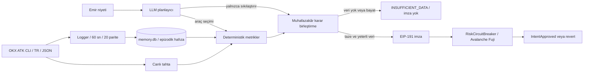

Arf is a pre-trade execution and liquidity shield for AI trading agents.
It measures OKX ATK order books, signs deterministic risk limits, and checks intents on Avalanche Fuji.
Missing or stale market data stops attestation issuance: fail-closed.

# Arf

ATK ile binlerce trading agent yazılacak; tahtanın emri kaldırıp kaldıramayacağını bilmeyen agent kendini batırır. Arf her emirden önce icra maliyetini ATK verisiyle ölçer, imzalar, Avalanche'taki devre kesiciye bağlar. Veri bozulunca işlemi kapalı bırakır (fail-closed).

**AI trading agent'lar için işlem öncesi icra ve likidite kalkanı.** Tek soru: “Bu emir bu tahtada kaça patlar, en fazla ne kadarlık emir güvenli?” Adı Cahit Arf ve Arf değişmezine gönderme yapar. Korunan değişmez: **hiçbir emir tahtanın taşıyabileceğinden (`maxSafeSize`) büyük olamaz.**

OKX TR × Team1 Agentic Hackathon, Ankara · 17 Ekim 2026 · Tek kişilik takım.
[GitHub](https://github.com/akifaybek/arf) · [Sunum dosyası](presentation/Arf.pptx)

## 1. Nasıl çalışır?

`check_execution(symbol, side, size_usdt)` canlı tahta ve epizodik hafızadan bir icra karnesi üretir. Alışta ask, satışta bid tarafı yürünür. Tutarlar USDT'dir.



- **Veri:** bütün piyasa verisi ATK CLI üzerinden, `OKX_SITE=tr` ve `--json` ile gelir. Doğrudan OKX REST/WS çağrısı kullanılmaz. Kapsam SPOT'tur.
- **Epizodik hafıza:** logger 20 paritede 60 saniye arayla veri toplar. Geçmiş medyan derinlikle karşılaştırma, piyasa rejimi değişimini değerlendirmeye yardım eder.
- **Metrikler:** median/MAD tabanlı robust z, derinlik değişimi, spread, dolum ve 1.000/10.000 USDT kayması. Bonferroni: `α=0,05`, `m=20`, iki yönlü z eşiği yaklaşık `3,023`.
- **Güvenli tutar:** amaç kaymayı %1 sınırında tutmaktır. Mevcut hesap `max_safe_size` için sınırdaki eşitliği de kabul eder (100 bps). Bu değer anlık tahta ölçümüdür, gelecekteki dolum garantisi değildir.

Veri 120 saniyeden eskiyse, alınamıyorsa veya tahta bozuksa `INSUFFICIENT_DATA` → `VERI_YETERSIZ` → **imza yok**. Hafıza kısaysa `OK_LIMITED_MEMORY` üretilebilir; bu, tamamen veri yokluğundan farklıdır ve skora muhafazakâr katkı eklenir.

## 2. Agentic tasarım

LLM hangi aracı ne zaman çağıracağını seçer. Araçlar: `scan_market`, `get_candles`, `get_orderbook`, `compute_metric`, `sign_score`. Planlayıcı bütçesi 12 araç çağrısıdır; final ölçüm/tazelik korumaları ayrıca çalışabilir. Karar izi araç adını, süreyi ve sonucu gösterir.

`sign_score` argümansızdır. İstenen sembol, yön ve tutarın deterministik ölçümü bağlayıcıdır; LLM başka ölçümün sayılarını imzaya geçiremez. LLM'e kullanıcıdan serbest metin gönderilmez, doğrulanmış niyet ve yapısal piyasa özetleri gider.

Muhafazakârlık sırası: **`VERI_YETERSIZ > RED > BOL > ONAY`**. LLM önerisi yalnızca daha muhafazakârsa uygulama kararını sıkılaştırır. Varsayılan sağlayıcı zinciri: Anthropic `claude-haiku-5-5` → Gemini → deterministik plan. LLM kesintisi tek başına piyasa verisi kesintisi anlamına gelmez; taze verilerle deterministik yol çalışabilir.

**Sınır:** kontrat LLM karar etiketini doğrulamaz, imzalı sayıları doğrular. Mevcut kodda veri yeterliyse `RED` ve `BOL` kararlarında da imza üretilebilir. Entegratör uygulama kararını ayrıca uygulamalıdır; LLM kaynaklı her sıkılaştırmanın zincirde zorlandığı iddia edilmez.

## 3. Avalanche üzerinde kanıt

| Alan | Değer |
|---|---|
| Ağ | Avalanche Fuji C-Chain, testnet, chainId `43113` |
| Kontrat | [`0xddE4C78F831f082E8AFDF716266bd1338B591159`](https://explorer-test.avax.network/c-chain/address/0xddE4C78F831f082E8AFDF716266bd1338B591159) |
| Deploy | [Deploy işlemi](https://explorer-test.avax.network/c-chain/tx/0x8f757f33eb3e627c3a69d6f4333be0dba200ae8f717e97698f2bc62d8e25bad7) |
| Derleme kaydı | Remix, solc 0.8.35, OpenZeppelin 5.6.1 |
| Risk eşiği | `5000`, owner `setRiskThreshold` ile değiştirebilir |
| İmza tazeliği | `MAX_AGE=300` sn, `MAX_FUTURE=60` sn |
| Yönetim | Ownable, Pausable, `pause`, `unpause`, `setOracle` |

İmzalanan özet: `keccak256(abi.encode(symbolHash, side, riskScore, maxSafeSize, timestamp, chainid, contract))`, ardından EIP-191. `symbolHash=keccak256(bytes(symbol))`, `side: 0=buy, 1=sell`. Kontrat tutarları **USDT × 10^6** tamsayısıdır; dönüşüm aşağı yuvarlar. Skor 0–10000 aralığındadır, yüksek skor daha yüksek risktir. Python–Solidity byte uyumu sabit test vektörüyle sınanır.

### Doğrulanmış işlem tablosu

Aşağıdaki **7 gerçek tx**, güncel STATUS.md ve app.py ana kanıt listesinden alınmıştır. Demo kapsamındaki dört revert kontrolü (`ExceedsSafeSize`, `BadSigner`, `AlreadyUsed`, `StaleScore`) artık gerçek tx ile kaydedilmiştir. Bu dokümantasyon çalışmasında yeni işlem gönderilmedi veya explorer üzerinden yeniden doğrulama yapılmadı. STATUS'ta kısaltılan iki agent hash'i app.py'den tamamlandı. Revert sebebi proje kaydındaki çözümlemeye dayanır; explorer tek başına yalnızca başarısızlık gösterebilir.

| Olay / kontrol | İşlem bağlantısı ve kanıt düzeyi |
|---|---|
| IntentApproved, ilk zincir kontrolü | [0x7bef94f2…ba5173](https://explorer-test.avax.network/c-chain/tx/0x7bef94f297de147acf74dce1139eca659e982e2ae51a51f013b2d89071ba5173) · gerçek tx |
| IntentApproved, agent 1.000 USDT | [0xa5798d59…aacbbe](https://explorer-test.avax.network/c-chain/tx/0xa5798d597f00a46e36c93a48f4423d46a18faf082d2006562140e4bd5eaacbbe) · gerçek tx |
| ExceedsSafeSize, ilk zincir kontrolü | [0x175eaee2…bf0e5](https://explorer-test.avax.network/c-chain/tx/0x175eaee2cdce982ad58988c3d73bb08944bf3d62fbcf91dcab1a973b8f4bf0e5) · gerçek tx |
| ExceedsSafeSize, agent 10.000 USDT | [0x80aeb849…667a6](https://explorer-test.avax.network/c-chain/tx/0x80aeb84999c64df29bec84dccedd6addb3b1c22adac4e69abd74fc29eb2667a6) · gerçek tx |
| BadSigner, veri kesintisi sahnesinde yetkisiz imza | [0x0b05e13f…de98e](https://explorer-test.avax.network/c-chain/tx/0x0b05e13fa25cb379d62f715820266a32db08250b40b19e2474940b5311ede98e) · gerçek tx |
| AlreadyUsed, taze onayın ikinci kullanımı | [0xa1ad9514…f99a80](https://explorer-test.avax.network/c-chain/tx/0xa1ad95144f813310c2b6c96457b35be32f71c3290f53d632f2b46baffbf99a80) · gerçek tx |
| StaleScore, eski ve kullanılmış onay | [0x0b290257…233a3](https://explorer-test.avax.network/c-chain/tx/0x0b29025776a1f03d8304fd01144ebe88741fe1d760ec405e5b8ebac9b91233a3) · gerçek tx |

Ana listeye ek hazırlık işlemi: **IntentApproved, 1 USDT**, [0x0b4cfc04…d23530](https://explorer-test.avax.network/c-chain/tx/0x0b4cfc04d3c91d5fe0fe09667d66eb07ef1bc630c8cec6b13ab47fe07ad23530). Bu onay tüketilip 3 saniye sonra yeniden gönderilerek AlreadyUsed kanıtlandı.

Geçmiş hata kaydı ayrıca korunur: simülasyon yolundan istenmeden gönderilen IntentApproved, [0x82f9fd48…f702b](https://explorer-test.avax.network/c-chain/tx/0x82f9fd48642b5f0777d85b724762294f634530ee9b38999e9f7eb4837fcf702b). Hata düzeltildi; bu işlem ana 7 tx sayısına dahil değildir.

Diğer kontrat kontrolleri: `RiskTooHigh`, `NoSafeSize`, `BadSide`, `ZeroAddress`. Bunların gerçek tx ile doğrulandığı iddia edilmez. `used[digest]` aynı onayın ikinci kullanımını engeller. Ağ ve kontrat adresinin imzaya katılması başka ağ/kontrat üzerinde kullanımını sınırlar.

## 4. Demo

Proje dizininde, sanal ortam açıkken:

```bash
python demo.py 1
python demo.py 2
python demo.py 3
```

Her komuta `--no-llm` eklenebilir: `python demo.py 2 --no-llm`. `1|2|3` bir sahne seçimidir; dikey çizgili ifadeyi terminale yazma.

| Sahne | Niyet | Gösterilen davranış |
|---|---|---|
| 1 | ZBCN-USDT buy, 1.000 USDT | Tahta uygunsa `ONAY`, imzalı icra karnesi |
| 2 | Aynı parite, 10.000 USDT | Güvenli tutar aşılırsa `BOL`, `ExceedsSafeSize` ön izlemesi ve N parçaya bölme önerisi |
| 3 | **SİMÜLASYON: veri kesintisi + yetkisiz imza** | `ARF_FEED_DOWN=1`, ATK çağrısı yok, oracle imzası yok; trader'ın kendi imzası `BadSigner` ile reddedilir |

Parça sayısı canlı tahtaya bağlıdır. Agent'ın önerdiği parça sayısı ile kontratın hesapladığı aynı formülü kullanır: `ceil(amount_units / maxSafeSize_units)`. Sıfır güvenli tutarda bölme önerisi yoktur.

CLI varsayılanında gerçek tx gönderilmez. Sahne 2 ve 3 kontrat cevabını `eth_call` ile gösterir; sahne 1 CLI'da imzayı gösterir. `--send` gerçek Fuji tx gönderir. Geçmiş gerçek işlemlerin bağlantıları yukarıdadır.

### Ekrandan demo

```bash
streamlit run app.py
```

1. Terminalin gösterdiği yerel adresi tarayıcıda aç.
2. Solda **Parite** alanında `ZBCN-USDT` bırak. **LLM kullan** açık kalsın.
3. **Zincire gönder** kutusunu kapalı tut; bu mod `eth_call` ön izlemesidir.
4. Sırayla **Sahne 1: 1.000 USDT**, **Sahne 2: 10.000 USDT**, **Sahne 3: veri kesintisi (SİMÜLASYON)** düğmelerine bas. Her koşunun bitmesini bekle.
5. Solda karar izini, ortada icra maliyetini, sağda kontrat cevabını göster. **Zincirde doğrulanmış kanıtlar** bağlantıları geçmiş gerçek işlemleri açar.

Tahta değiştiğinde sahne 1/2 kararları da değişebilir. Ağ veya LLM kotası sorununda **LLM kullan** kutusunu kapat. Kayıt akışı için [video senaryosu](presentation/video_script.md).

## 5. Kötü senaryoda ne oluyor?

| Senaryo | Mevcut karşılık | Sınır |
|---|---|---|
| Oracle anahtarı çalınır | Owner `pause`, ardından `setOracle` kullanır | Müdahale gerekir; tek oracle güven varsayımı sürer |
| LLM yanlış yorumlar veya yönlendirilmeye çalışılır | Yapısal veri, deterministik sayılar, argümansız imza aracı, muhafazakâr karar birleştirme | Uygulama karar etiketi zincirde imzalanmıyor |
| Yanlış alarm | Zincirde parametrik risk eşiği, Bonferroni düzeltmesi | Robust z için dağılım kalibrasyonu ampirik olarak kanıtlanmadı |
| Piyasa verisi kesilir/bayatlar | `INSUFFICIENT_DATA`, imza yok | Önceden verilmiş imza kontratın 300 sn penceresinde geçerli kalabilir; tüm eski imzalar anında iptal olmaz |
| Aynı imza yeniden kullanılır | Önce tazelik kontrolü: eski onay `StaleScore`; 300 sn penceresinde tüketilmiş onay `AlreadyUsed` | İki katman da gerçek tx ile ölçüldü |

**İki katmanlı replay koruması:** kontrat tazelik kontrolünü replay kontrolünden önce yapar. Bu yüzden eski bir onay, daha önce kullanılmış olsa da `StaleScore` ile reddedilir; 300 saniyelik geçerlilik penceresindeki kullanılmış onay ise `AlreadyUsed` ile reddedilir. STATUS kaydında eski onay yaklaşık 1655 sn yaşındaydı; taze onay hazırlık işleminden 3 sn sonra tekrar gönderildi. Her iki yol da zincirde gerçek tx ile ölçüldü.

**Acil çıkış / reduce-only bypass yalnızca kavramdır, kodlanmadı.**

## 6. Ölçülen sayılar

Canlı piyasa ölçümleri 17 Ekim 2026 proje kayıtları ve hackathon notlarından alınmıştır. Burada piyasa/LLM/zincir koşuları yeniden çalıştırılmadı. Süreler örnek koşulardır, servis garantisi değildir.

| Ölçüm | Sonuç | Kaynak / kapsam |
|---|---|---|
| Zincir onayı | Yaklaşık 1,5–2,3 sn | STATUS gerçek tx kayıtları; yeni replay/tazelik kanıtları dahil, zincir kontrolü yaklaşık 2 sn ekliyor |
| LLM istek ve maliyeti | Yaklaşık 3 istek, $0,001/koşu | STATUS koşu kaydı, token sayısından proje fiyat tablosuyla tahmin; güncel tarife iddiası değil |
| LLM ile sahne süresi | Yaklaşık 9–12 sn | Demo kaydı; ayrı agent koşusu 12,919 sn |
| LLM'siz sahne süresi | Yaklaşık 3 sn | Hackathon ölçüm notu; sahne/ağ koşulları değişir |
| BIGTIME-USDT, 1.000 USDT | 10,8 bps kayma | Hackathon ölçüm notu |
| BIGTIME-USDT, 10.000 USDT | 1284 bps kayma | Hackathon ölçüm notu: 10× tutar, 100× üzerinde kayma oranı |
| ZBCN-USDT, 1.000 USDT | `ONAY`, skor yaklaşık 523, güvenli tutar yaklaşık 5.200–5.460 USDT, kayma yaklaşık 13 bps | Son hackathon ölçüm notu; canlı tahtada değişir |
| Gün içi skor aralığı | 323–2841; eşik 5000 | Hackathon ölçüm notu; eşik zincirde parametrik |
| Epizodik hafıza | 20 parite, 60 sn aralık | STATUS: logger başlangıcı 13:14:45, kesintisiz kayıt bildirimi; bu çalışmada süreç kontrol edilmedi |
| Python testleri | **87 geçti / 87** | Claude bildirimi; burada açık kontrat adresi ortamdan verilerek ağsız testler tekrar koşuldu, ortam dosyası yüklemesi ve önbellek yazımı kapalı. Gerçek `.env` yükleme entegrasyonu bu koşuda sınanmadı |
| Solidity testleri | 14 geçti / 14 | STATUS kaydı; burada yeniden çalıştırılmadı |

## 7. Varsayımlar ve dürüst sınırlar

**VARSAYIM / tasarım tercihi:** risk ağırlıkları kayma `0,35`, derinlik düşüşü `0,20`, anomali z `0,15`, spread `0,15`, dolmama `0,15`. Bunlar veriden kalibre edilmiş parametreler değildir. %1 kayma sınırı, veri yaş eşikleri ve araç bütçesi de tasarım tercihidir.

- Bölme önerisi, parçalar arasında tahtanın yeniden dolduğunu varsayar. Yeniden dolum hızı ölçülmez; icra takvimi ve dolum garantisi yoktur.
- Robust z normal dağılıma dayanan nominal eşikle karşılaştırılır. Bonferroni düzeltmesi parite ailesini ele alır; bütün metrikler ve zaman boyunca ampirik %5 yanlış alarm garantisi verilmez. Mevcut z bileşenleri log-getiri ve log-derinliktir.
- 400 seviye bazen ±%2 bandını kapsamaz. `book_truncated` derinliğin alt sınır olabileceğini işaretler. Güvenli tutarın alt sınır olması ayrıca `max_safe_is_lower_bound` ile izlenir.
- Veri yaşı adaptörün `fetched_at` zamanına dayanır. Piyasa değişebilir; imzadan sonraki tahta hareketi ve icra gecikmesi korunmuş değildir.
- **Tek oracle, testnet ve owner yetkileri** güven sınırıdır. Kontrat niyeti doğrular ve olay üretir; OKX üzerinde kendisi emir yürütmez. Koruma, bu kontrolü zorunlu kullanan entegrasyon için geçerlidir.
- İmza sembol/yön/skor/güvenli tutar/zaman/ağ/kontratı bağlar; emir tutarı ve çağıran adres payload'da yoktur. İlk geçerli kullanım onayı tüketir. Müşteri bazlı nonce/yetkilendirme bu prototipte yoktur.
- Simülasyon yolunun bir kez yanlışlıkla gerçek tx gönderdiği kayda geçti. `dry_run` kilidi ve 8 güvenlik regresyon testiyle düzeltildi; işlem tablosu bu kaydı saklar.
- Arf kaldıraç/likidasyon koruyucusu değildir. Kayma hesabı mid'e göredir ve yarım spread'i içerir; toplam icra maliyetinin bütün bileşenlerinin ölçüldüğü iddia edilmez.

**SONRAKİ ADIM, KODLANMADI:** çoklu oracle / eşik imza, EIP-712, Almgren–Chriss icra planı, OKX.ai listeleme, çağrı başına ödeme (HTTP 402), mainnet / Avalanche L1. MCP sunucusu ve ücretli servis yayını mevcut teslimde yoktur.

## 8. Kurulum

Python 3.11+ hedeflenir; repo bağımlılık kaydı Python 3.14.0 sanal ortamından alınmıştır. Aşağıdaki komutları proje klasöründe sırayla çalıştır:

```bash
cd /Applications/arf
python3 -m venv .venv
source .venv/bin/activate
python -m pip install -r requirements.txt
```

ATK CLI ayrı kurulmalıdır. STATUS'ta doğrulanan sürüm `1.4.8`; kurulum komutu bu repoda [DOĞRULANACAK]. `okx` terminalden erişilebilir olmalı. Piyasa verisi için emir yetkili profil kullanma. Repoda doğrulanan salt veri komutu:

```bash
OKX_SITE=tr okx market orderbook BTC-USDT --sz 400 --json
```

### Ortam alanları

`.env.example` dosyası okunarak alan adları çıkarıldı. Burada hiçbir ortam değeri paylaşılmaz. Finder'da **Cmd+Shift+G** ile `/Applications/arf` klasörüne git, **Cmd+Shift+.** ile gizli dosyaları göster. İlk kurulumda `.env.example` dosyasını çoğaltıp kopyayı `.env` olarak adlandır. Mevcut `.env` varsa üzerine yazma. Kendi değerlerini yalnızca yerel dosyada gir ve bu dosyayı paylaşma.

| `.env.example` alanı | Amaç |
|---|---|
| `OKX_SITE` | ATK site seçimi |
| `LLM_API_KEY` | Gemini yedek sağlayıcı kimlik bilgisi |
| `ORACLE_` + `PRIVATE` + `_KEY` | Üç parçayı boşluksuz birleştir: oracle imzalayıcı ortam alanının tam adı |
| `FUJI_RPC_URL` | Fuji RPC uç noktası |
| `CONTRACT_ADDRESS` | Deploy edilmiş devre kesici adresi |

Şablonun Anthropic ve trader alanlarını içermediği görüldü. Kaynakta Anthropic için `ANTHROPIC_API_KEY`, isteğe bağlı sağlayıcı seçimi için `LLM_PROVIDER` kullanılıyor. Sahne 3'ün trader imzası için `chain.py` ayrıca `TRADER_` + `PRIVATE` + `_KEY` alanını kullanır; bu alan da şablonda yoktur. Eksik alanların yerel yapılandırmasını ekip tamamlamalıdır. Kimlik bilgisi veya hesap anahtarı dokümantasyona kopyalanmaz. Taze logger verisi yoksa ölçüm sınırlı hafıza durumuna geçebilir; kurulum, geçmiş epizodik hafızayı kendiliğinden üretmez.

## 9. OKX.ai servis tanımı

**A2MCP'ye uyarlanabilir şema.** Bu bölüm servis tasarımıdır; resmi A2MCP biçimiyle doğrulama, çalışan MCP sunucusu ve gerçek OKX.ai listelemesi yapılmadı. Bugün çağrılabilen Python girişi `agent.check_execution(symbol, side, size_usdt)` adıdır. Tasarlanan dış servisteki `size`, adaptörde `size_usdt` alanına eşlenir.

Giriş JSON Schema:

```json
{
  "type": "object",
  "required": ["symbol", "side", "size"],
  "additionalProperties": false,
  "properties": {
    "symbol": {"type": "string", "pattern": "^[A-Z0-9]+-USDT$"},
    "side": {"type": "string", "enum": ["buy", "sell"]},
    "size": {"type": "number", "exclusiveMinimum": 0, "description": "USDT tutarı"}
  }
}
```

Çıkış JSON Schema (önerilen servis sözleşmesi):

```json
{
  "type": "object",
  "required": ["decision", "riskScore", "maxSafeSize", "execution_plan", "signed_attestation", "reasoning"],
  "properties": {
    "decision": {"enum": ["ONAY", "BOL", "RED", "VERI_YETERSIZ"]},
    "riskScore": {"type": ["integer", "null"], "minimum": 0, "maximum": 10000},
    "maxSafeSize": {"type": ["number", "null"], "minimum": 0, "description": "USDT"},
    "execution_plan": {
      "type": ["object", "null"],
      "required": ["parts", "method"],
      "properties": {
        "parts": {"type": "integer", "minimum": 1},
        "method": {"const": "ceil_size_over_max_safe"}
      }
    },
    "signed_attestation": {
      "type": ["object", "null"],
      "required": ["symbol", "side", "riskScore", "maxSafeSize", "timestamp", "digest", "signature"],
      "properties": {
        "symbol": {"type": "string"},
        "side": {"enum": ["buy", "sell"]},
        "riskScore": {"type": "integer", "minimum": 0, "maximum": 10000},
        "maxSafeSize": {"type": "integer", "minimum": 0, "description": "Kontrat birimi: USDT × 10^6"},
        "timestamp": {"type": "integer", "description": "Unix saniye"},
        "digest": {"type": "string"},
        "signature": {"type": "string"}
      }
    },
    "reasoning": {"type": "string"}
  }
}
```

Bugünkü Python çıktısı `split_suggestion`, `reason`, `trace` ve `llm_final` içerir. Önerilen adaptör bunları `execution_plan` / `reasoning` alanlarına dönüştürecektir; mevcut fonksiyonun birebir bu JSON'u döndürdüğü iddia edilmez. Veri yetersizliğinde skor, güvenli tutar, plan ve imza `null` olmalıdır. Güvenli tutar sıfırsa plan yoktur. Her parça için yeniden kontrol gerekir; aynı imza tekrar kullanılamaz.

## 10. İş modeli

Hedef müşteri ATK ile agent geliştiren ekipler ve bireysel kullanıcılardır. Temel kontrol ücretsiz, gerçek zamanlı/API erişimi ücretli servis olarak tasarlandı. Çağrı başına ödeme ve OKX.ai listeleme sonraki adımdır. Fiyat, ödeme isteği ve gelir [DOĞRULANACAK].

## 11. Demo videosu ve teslim

Demo videosu: **[LİNK EKLENECEK]**

Sunum paylaşım bağlantısı: **[GOOGLE SLAYTLAR LİNKİ]**

[Form cevapları](presentation/form_answers.md) · [Jüri soru-cevapları](presentation/qa.md) · [Google Slaytlar yükleme adımları](presentation/upload_steps.md)
