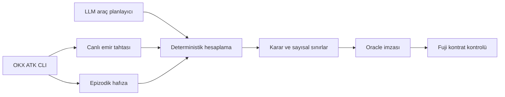

# Arf

**AI trading agent'lar için işlem öncesi icra ve likidite kontrolü.**

Arf, bir emrin mevcut emir tahtasında oluşturacağı kaymayı hesaplar, belirlenen kayma sınırına uygun en büyük tutarı bulur ve sonuçları Avalanche Fuji üzerinde doğrulanabilen bir oracle imzasıyla sunar.

Pre-trade execution checks powered by OKX Agent Trade Kit and Avalanche.

**1.lik — OKX TR × Team1 Agentic Hackathon · Ankara · 17 Ekim 2026**

[Etkileşimli demo](https://arf-icra-demo.copperspoon2.chatgpt.site/) · [Sunum](presentation/Arf.pptx) · [Teknik mimari](docs/architecture.md) · [Zincir kanıtları](docs/validation.md)

> İnternet demosu kayıtlı verilerle çalışan bir simülasyondur. Canlı piyasa verisi, yeni imza veya işlem üretmez. Canlı ATK entegrasyonu yerel uygulamada çalışır.

## Problem

Ekrandaki fiyat, büyük bir emrin tamamının o fiyattan gerçekleşeceği anlamına gelmez. Emir büyüdükçe farklı fiyat seviyeleri tüketilir; ortalama gerçekleşme fiyatı ve icra maliyeti değişir. Sabit bir emir limiti, piyasalar arasındaki likidite farkını veya gün içindeki değişimi tek başına yansıtmaz.

Arf, her emirden önce iki soruya cevap verir:

- Bu tutarın mevcut tahtadaki tahmini kayması ne kadar?
- Seçilen kayma sınırı içinde kalabilecek en büyük emir tutarı ne?

## Nasıl çalışır?



1. **Veri:** ATK CLI üzerinden spot fiyat, mum ve emir tahtası okunur. Logger, 20 pariteyi 60 saniye arayla gözlemleyerek yerel SQLite hafızasına kaydeder.
2. **Hesap:** Emir tahtası seviyeleri yürünerek ortalama fiyat, kayma ve `maxSafeSize` hesaplanır. Varsayılan kayma sınırı %1'dir; sınırdaki eşitlik kabul edilir.
3. **Planlama:** LLM araçları seçer ve sonuçları yorumlar. Risk skoru ve güvenli tutar deterministik koddan gelir. LLM önerisi uygulama kararını yalnızca daha muhafazakâr yapabilir.
4. **Doğrulama:** Oracle sonucu EIP-191 ile imzalar. Fuji kontratı imzayı, tazeliği, tekrar kullanımı, risk eşiğini ve emir tutarını kontrol eder.

Güncel tahta alınamazsa, bozuksa veya adaptörün veri alma zamanına göre 120 saniyeden eskiyse yeni imza üretilmez. Geçmiş kayıt sayısı azsa ölçüm sınırlı hafıza durumuyla devam edebilir.

## Çalışan kapsam

| Bileşen | Mevcut işlev |
|---|---|
| Piyasa verisi | OKX Agent Trade Kit CLI, TR sitesi, spot piyasalar |
| Metrikler | Kayma, spread, dolum, derinlik değişimi, robust z ve güvenli tutar |
| Planlayıcı | Araç çağrıları, karar izi ve deterministik yedek akış |
| İmza | Python ile EIP-191; Python–Solidity test vektörleri |
| Kontrat | Avalanche Fuji üzerinde onay, eşik ve tekrar kullanım kontrolleri |
| Arayüz | Yerel Streamlit uygulaması ve ayrı, kayıtlı verili internet demosu |

ATK bağlantısı CLI üzerinden yapılır. MCP sunucusu, OKX.ai listelemesi, ödeme katmanı ve otomatik OKX emir icrası mevcut sürümde bulunmaz.

## Yerelde çalıştırma

Python 3.11+ ve terminalden erişilebilir [OKX Agent Trade Kit CLI](https://github.com/okx/agent-trade-kit) gerekir. Geliştirmede ATK 1.4.8 kullanılmıştır. Piyasa verileri için salt okunur erişim kullanın.

```bash
git clone https://github.com/akifaybek/arf.git
cd arf
python3 -m venv .venv
source .venv/bin/activate
python -m pip install -r requirements.txt
```

ATK erişimini kontrol edin:

```bash
OKX_SITE=tr okx market orderbook BTC-USDT --sz 400 --json
```

### Yapılandırma

İlk kurulumda `.env.example` dosyasından yerel bir `.env` oluşturun. Mevcut `.env` dosyasını koruyun; kimlik bilgilerini yalnızca yerel ortamda saklayın.

| Ortam değişkeni | Kullanım |
|---|---|
| `OKX_SITE` | ATK site seçimi: `tr` |
| `ANTHROPIC_API_KEY` | Anthropic planlayıcı erişimi |
| `LLM_API_KEY` | Gemini yedek planlayıcı erişimi |
| `LLM_PROVIDER` | İsteğe bağlı başlangıç sağlayıcısı |
| `ORACLE_PRIVATE_KEY` | Yerel oracle imzalayıcısı; yalnızca testnet anahtarı kullanın |
| `FUJI_RPC_URL` | Fuji RPC bağlantısı |
| `CONTRACT_ADDRESS` | Fuji kontrat adresi |
| `TRADER_PRIVATE_KEY` | Üçüncü demo senaryosundaki yetkisiz imza testi ve isteğe bağlı testnet gönderimi |

Şablonda bulunmayan alanları kullanacağınız özelliklere göre yerel `.env` dosyasına ekleyin. LLM erişimi olmadığında deterministik yedek akış kullanılabilir; imzalı canlı akış için oracle yapılandırması gerekir.

Arayüzü başlatın:

```bash
streamlit run app.py
```

Terminalin verdiği yerel adresi açın. Varsayılan arayüz kontrat çağrısını `eth_call` ile simüle eder; zincire işlem göndermez. **Zincire gönder** seçeneği gerçek Fuji işlemi oluşturur.

Geçmiş gözlemleri toplamak için ayrı bir terminalde aynı sanal ortamla `python logger.py` çalıştırılabilir. Logger veri toplar; kurulum mevcut bir geçmiş veri kümesi sağlamaz.

### Komut satırı senaryoları

```bash
python demo.py 1 --no-llm
python demo.py 2 --no-llm
python demo.py 3 --no-llm
```

| Senaryo | Gösterilen davranış |
|---|---|
| 1 | 1.000 USDT niyeti: ölçülen sınırlar uygunsa onay |
| 2 | 10.000 USDT niyeti: güvenli tutar aşılırsa bölme önerisi ve kontrat reddi ön izlemesi |
| 3 | Etiketli veri kesintisi simülasyonu: yeni oracle imzası yok; yetkisiz imza reddi |

İlk iki senaryonun sonucu güncel tahtaya bağlıdır. CLI varsayılanında işlem gönderilmez; `--send` gerçek testnet işlemi gönderir. LLM planlayıcıyı kullanmak için `--no-llm` bayrağını kaldırın.

## Fuji kanıtları ve testler

**Kontrat:** [`0xddE4C78F831f082E8AFDF716266bd1338B591159`](https://explorer-test.avax.network/c-chain/address/0xddE4C78F831f082E8AFDF716266bd1338B591159) · chainId `43113`

Yedi ana işlem kaydı; başarılı onayları ve `ExceedsSafeSize`, `BadSigner`, `AlreadyUsed`, `StaleScore` reddetmelerini içerir. İşlem bağlantıları, hazırlık işlemi, geçmiş hata kaydı ve ölçüm sınırları [doğrulama belgesinde](docs/validation.md) bulunur.

Kayıtlı test sonuçları: **87 Python testi**, **14 Solidity testi**. Koşum kapsamı ve komutları aynı belgede açıklanmıştır.

```bash
python -m pytest -q
```

Solidity testleri için Foundry ve npm gerekir:

```bash
npm ci
forge test -vv
```

## Güven modeli ve sınırlar

- Risk skoru açıklanabilir bir ağırlıklı toplamdır; zarar olasılığı değildir. Ağırlıklar ve eşikler henüz gerçek gerçekleşme verileriyle kalibre edilmemiştir.
- `maxSafeSize`, gözlenen tahta ve seçilen kayma sınırı için bir ölçümdür. Gelecekte dolum, kâr veya parçalar arasında likiditenin yenilenmesi garanti edilmez.
- Tek oracle ve owner yetkileri güven varsayımıdır. Kontrat imzalı sayıları doğrular; zincir dışındaki hesabı yeniden yapmaz ve LLM karar etiketini denetlemez.
- Kontrat işlem niyetini onaylar veya reddeder. OKX'te kendisi emir göndermez; icra entegrasyonu uygulama kararını ve kontrat kontrolünü uygulamalıdır.
- İmza 300 saniyelik pencereye sahiptir. Veri kesintisi daha önce verilmiş imzaları anında iptal etmez. İmzalı sonuç çağıran adrese veya kesin emir tutarına bağlı değildir; ilk başarılı kullanımda tüketilir.

Ayrıntılar: [Teknik mimari ve varsayımlar](docs/architecture.md).

## Yol haritası

Çoklu oracle ve eşik imza, EIP-712 ile daha ayrıntılı yetkilendirme, gerçekleşme verileriyle kalibrasyon ve her parça öncesi yeniden kontrol içeren icra entegrasyonu planlanmaktadır. MCP servis katmanı, OKX.ai listelemesi ve çağrı başına ödeme önerilen geliştirmelerdir.

Arf adı, Cahit Arf'a ve değişmez fikrine gönderme yapar. Proje matematiksel Arf değişmezini hesaplamaz.
