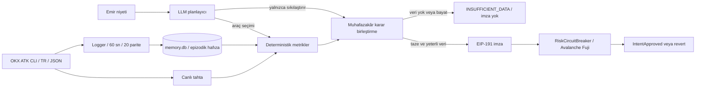

# Teknik mimari

Arf, OKX Agent Trade Kit CLI üzerinden alınan spot piyasa verisini deterministik icra ölçümlerine ve Avalanche Fuji üzerinde doğrulanan imzalı sınırlara dönüştürür.

[Ana sayfa](../README.md) · [Zincir kanıtları ve doğrulama](validation.md)

## Veri akışı

`check_execution(symbol, side, size_usdt)` canlı tahta ve epizodik hafızadan bir icra karnesi üretir. Alışta ask, satışta bid tarafı yürünür. Tutarlar USDT'dir.



- **Veri:** bütün piyasa verisi ATK CLI üzerinden, `OKX_SITE=tr` ve `--json` ile gelir. Doğrudan OKX REST/WS çağrısı kullanılmaz. Kapsam SPOT'tur.
- **Epizodik hafıza:** logger 20 paritede 60 saniye arayla veri toplar. Geçmiş medyan derinlikle karşılaştırma, piyasa rejimi değişimini değerlendirmeye yardım eder.
- **Metrikler:** median/MAD tabanlı robust z, derinlik değişimi, spread, dolum ve 1.000/10.000 USDT kayması. Bonferroni: `α=0,05`, `m=20`, iki yönlü z eşiği yaklaşık `3,023`.
- **Güvenli tutar:** amaç kaymayı %1 sınırında tutmaktır. Mevcut hesap `max_safe_size` için sınırdaki eşitliği de kabul eder (100 bps). Bu değer anlık tahta ölçümüdür, gelecekteki dolum garantisi değildir.

Veri 120 saniyeden eskiyse, alınamıyorsa veya tahta bozuksa `INSUFFICIENT_DATA` → `VERI_YETERSIZ` → **imza yok**. Hafıza kısaysa `OK_LIMITED_MEMORY` üretilebilir; bu, tamamen veri yokluğundan farklıdır ve skora muhafazakâr katkı eklenir.

## Planlayıcı ve karar birleştirme

LLM hangi aracı ne zaman çağıracağını seçer. Araçlar: `scan_market`, `get_candles`, `get_orderbook`, `compute_metric`, `sign_score`. Planlayıcı bütçesi 12 araç çağrısıdır; final ölçüm/tazelik korumaları ayrıca çalışabilir. Karar izi araç adını, süreyi ve sonucu gösterir.

`sign_score` argümansızdır. İstenen sembol, yön ve tutarın deterministik ölçümü bağlayıcıdır; LLM başka ölçümün sayılarını imzaya geçiremez. LLM'e kullanıcıdan serbest metin gönderilmez, doğrulanmış niyet ve yapısal piyasa özetleri gider.

Muhafazakârlık sırası: **`VERI_YETERSIZ > RED > BOL > ONAY`**. LLM önerisi yalnızca daha muhafazakârsa uygulama kararını sıkılaştırır. Varsayılan sağlayıcı zinciri: Anthropic `claude-haiku-5-5` → Gemini → deterministik plan. LLM kesintisi tek başına piyasa verisi kesintisi anlamına gelmez; taze verilerle deterministik yol çalışabilir.

**Sınır:** kontrat LLM karar etiketini doğrulamaz, imzalı sayıları doğrular. Mevcut kodda veri yeterliyse `RED` ve `BOL` kararlarında da imza üretilebilir. Entegratör uygulama kararını ayrıca uygulamalıdır; LLM kaynaklı her sıkılaştırmanın zincirde zorlandığı iddia edilmez.

## Varsayımlar ve sınırlar

**VARSAYIM / tasarım tercihi:** risk ağırlıkları kayma `0,35`, derinlik düşüşü `0,20`, anomali z `0,15`, spread `0,15`, dolmama `0,15`. Bunlar veriden kalibre edilmiş parametreler değildir. %1 kayma sınırı, veri yaş eşikleri ve araç bütçesi de tasarım tercihidir.

- Bölme önerisi, parçalar arasında tahtanın yeniden dolduğunu varsayar. Yeniden dolum hızı ölçülmez; icra takvimi ve dolum garantisi yoktur.
- Robust z normal dağılıma dayanan nominal eşikle karşılaştırılır. Bonferroni düzeltmesi parite ailesini ele alır; bütün metrikler ve zaman boyunca ampirik %5 yanlış alarm garantisi verilmez. Mevcut z bileşenleri log-getiri ve log-derinliktir.
- 400 seviye bazen ±%2 bandını kapsamaz. `book_truncated` derinliğin alt sınır olabileceğini işaretler. Güvenli tutarın alt sınır olması ayrıca `max_safe_is_lower_bound` ile izlenir.
- Veri yaşı adaptörün `fetched_at` zamanına dayanır. Piyasa değişebilir; imzadan sonraki tahta hareketi ve icra gecikmesi korunmuş değildir.
- **Tek oracle, testnet ve owner yetkileri** güven sınırıdır. Kontrat niyeti doğrular ve olay üretir; OKX üzerinde kendisi emir yürütmez. Koruma, bu kontrolü zorunlu kullanan entegrasyon için geçerlidir.
- İmza sembol/yön/skor/güvenli tutar/zaman/ağ/kontratı bağlar; emir tutarı ve çağıran adres payload'da yoktur. İlk geçerli kullanım onayı tüketir. Müşteri bazlı nonce/yetkilendirme bu prototipte yoktur.
- Simülasyon yolunun bir kez yanlışlıkla gerçek tx gönderdiği kayda geçti. `dry_run` kilidi ve güvenlik regresyon testleriyle düzeltildi; [doğrulama belgesi](validation.md) bu kaydı saklar.
- Arf kaldıraç/likidasyon koruyucusu değildir. Kayma hesabı mid'e göredir ve yarım spread'i içerir; toplam icra maliyetinin bütün bileşenlerinin ölçüldüğü iddia edilmez.

**Yol haritası:** çoklu oracle / eşik imza, EIP-712, Almgren–Chriss icra planı, OKX.ai listeleme, çağrı başına ödeme (HTTP 402), mainnet / Avalanche L1. MCP sunucusu ve ücretli servis yayını mevcut sürümde yoktur.

## Önerilen servis sözleşmesi

**A2MCP'ye uyarlanabilir şema.** Bu bölüm servis tasarımıdır; resmi A2MCP biçimiyle doğrulama, çalışan MCP sunucusu ve gerçek OKX.ai listelemesi yapılmadı. Bugün çağrılabilen Python girişi `agent.check_execution(symbol, side, size_usdt)` adıdır. Tasarlanan dış servisteki `size`, adaptörde `size_usdt` alanına eşlenir.

Giriş JSON Schema:

```json
{
  "type": "object",
  "required": ["symbol", "side", "size"],
  "additionalProperties": false,
  "properties": {
    "symbol": {"type": "string", "pattern": "^[A-Z0-9]+-USDT$"},
    "side": {"type": "string", "enum": ["buy", "sell"]},
    "size": {"type": "number", "exclusiveMinimum": 0, "description": "USDT tutarı"}
  }
}
```

Çıkış JSON Schema (önerilen servis sözleşmesi):

```json
{
  "type": "object",
  "required": ["decision", "riskScore", "maxSafeSize", "execution_plan", "signed_attestation", "reasoning"],
  "properties": {
    "decision": {"enum": ["ONAY", "BOL", "RED", "VERI_YETERSIZ"]},
    "riskScore": {"type": ["integer", "null"], "minimum": 0, "maximum": 10000},
    "maxSafeSize": {"type": ["number", "null"], "minimum": 0, "description": "USDT"},
    "execution_plan": {
      "type": ["object", "null"],
      "required": ["parts", "method"],
      "properties": {
        "parts": {"type": "integer", "minimum": 1},
        "method": {"const": "ceil_size_over_max_safe"}
      }
    },
    "signed_attestation": {
      "type": ["object", "null"],
      "required": ["symbol", "side", "riskScore", "maxSafeSize", "timestamp", "digest", "signature"],
      "properties": {
        "symbol": {"type": "string"},
        "side": {"enum": ["buy", "sell"]},
        "riskScore": {"type": "integer", "minimum": 0, "maximum": 10000},
        "maxSafeSize": {"type": "integer", "minimum": 0, "description": "Kontrat birimi: USDT × 10^6"},
        "timestamp": {"type": "integer", "description": "Unix saniye"},
        "digest": {"type": "string"},
        "signature": {"type": "string"}
      }
    },
    "reasoning": {"type": "string"}
  }
}
```

Bugünkü Python çıktısı `split_suggestion`, `reason`, `trace` ve `llm_final` içerir. Önerilen adaptör bunları `execution_plan` / `reasoning` alanlarına dönüştürecektir; mevcut fonksiyonun birebir bu JSON'u döndürdüğü iddia edilmez. Veri yetersizliğinde skor, güvenli tutar, plan ve imza `null` olmalıdır. Güvenli tutar sıfırsa plan yoktur. Her parça için yeniden kontrol gerekir; aynı imza tekrar kullanılamaz.
